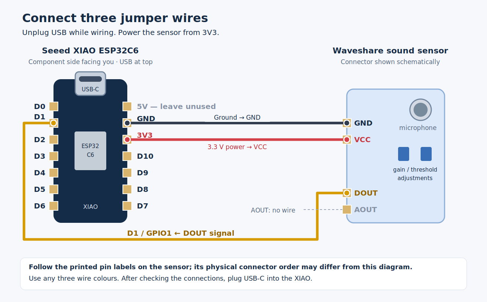

# Thread ClapClap

A three-wire, USB-powered **double-clap button for Home Assistant**, using a
Seeed XIAO ESP32-C6 and Waveshare Sound Sensor. Two short sound bursts send one
Matter Generic Switch click over Thread. The firmware also enables Thread
router eligibility to let the device help relay mesh traffic.

**Status:** firmware compiles with Arduino ESP32 **3.3.12**, all 14 host detector
tests pass, and USB flashing, startup, and Home Assistant commissioning have
been verified on a physical XIAO. Serial logs confirm Thread attachment,
automatic promotion from child to **router**, and two recognised double-clap
sequences reaching the Matter click API. Home Assistant event delivery, sensor
tuning, and traffic-forwarding/coverage measurements still need validation.
This is an MIT-licensed community prototype, not a certified Matter product.

## 1. Connect the hardware

**Unplug USB before wiring.** Use three female-to-female jumper wires. The
XIAO must have its headers fitted, and the sensor must have accessible pins.



| Waveshare sound sensor | XIAO ESP32-C6 | Example wire colour |
| --- | --- | --- |
| VCC | **3V3** | Red |
| GND | **GND** | Black |
| DOUT | **D1 / GPIO1** | Yellow |
| AOUT | Unconnected | — |

With the XIAO's **component side facing you and USB-C socket at the top**, D1
is the second pin down on the left; GND is the second down on the right; 3V3
is the third down on the right. Follow the **printed sensor pin labels**:
its connector in the illustration is schematic, not a physical pin-order guide.
Wire colours are your choice.

Power the sensor from **3V3**, keeping DOUT at ESP32-compatible logic voltage.
Do not use the 5V header pin for this connection. The sensor's DOUT is
**active-low**: loud sound pulls it LOW.

If you already connected DOUT to **D0/GPIO0** using the original discussion,
either move that wire to D1, or change `soundPin` to `0` in
[`Config.h`](firmware/ThreadClapClap/Config.h) before building. Firmware and
wiring must agree. No analog connection is needed for this version.

Once checked, connect a **USB-C data cable** to the computer. After flashing,
a standard USB supply can power it continuously.

## 2. Build and flash

Install [Arduino CLI](https://arduino.github.io/arduino-cli/latest/installation/)
and Python 3.10 or newer. Commands below run from the repository root; use
`python` in place of `python3` on Windows if needed.

```sh
python3 tools/project.py setup
python3 tools/project.py build
python3 tools/project.py ports
python3 tools/project.py flash --port /dev/ttyACM0
python3 tools/project.py monitor --port /dev/ttyACM0
```

Replace `/dev/ttyACM0` with the detected port (for example **COM7** on Windows,
or `/dev/cu.usbmodem…` on macOS). `setup` downloads and installs the pinned
ESP32 core and its toolchains. `flash` uploads the last local build; rebuild
after changing the source. Close other serial monitors before uploading.
The console runs at **115200 baud**. Press RESET after opening it if you missed
the startup pairing code.

The script selects `XIAO_ESP32C6`, USB CDC enabled, and **Huge APP (3MB No OTA)**.
The first verified build uses approximately 2.66 MB of flash (84% of that app
partition). There is no OTA update implementation; updates use USB.

For Arduino IDE, add Espressif's board-manager URL
`https://espressif.github.io/arduino-esp32/package_esp32_index.json`, install
**esp32 by Espressif Systems 3.3.12**, and open
[`ThreadClapClap.ino`](firmware/ThreadClapClap/ThreadClapClap.ino).
Select **XIAO_ESP32C6**, **Huge APP (3MB No OTA/1MB SPIFFS)**, and **USB CDC On
Boot: Enabled**. Keep Zigbee mode disabled. No separate libraries are needed.

### Windows / WSL

Windows USB devices are not automatically visible in WSL. You can use Arduino
CLI/IDE directly on Windows, or attach this board to WSL with
[usbipd-win](https://learn.microsoft.com/windows/wsl/connect-usb):

```powershell
# Windows PowerShell: list devices and identify the ESP32 USB/JTAG serial device.
usbipd list
# Run once in an Administrator PowerShell (replace the example BUSID).
usbipd bind --busid 4-4
# Run in a regular PowerShell while WSL is running.
usbipd attach --wsl --busid 4-4
```

Run `python3 tools/project.py ports` in WSL afterwards. BUSIDs can change after
unplugging; attach only the XIAO. If the upload port disappears, hold BOOT,
press and release RESET, then release BOOT to enter the USB bootloader; list
ports again and retry the upload. Press RESET afterwards to run the firmware.

## 3. Pair with Home Assistant

You need an existing, operational **Thread Border Router**, Home Assistant's
Matter integration/Matter Server, local IPv6 connectivity, and the Home
Assistant Companion app on a phone with Bluetooth. The phone must know your
Thread network credentials. The clapper joins that network; the firmware never
creates its own Thread dataset.

1. Start the board and open its serial console. Find **Manual pairing code**
   or open the printed QR code URL on a second screen.
2. In the Companion app, add a **new Matter device** and scan that code or
   enter the manual code. Approve the development/uncertified-device prompt
   if your controller displays one. Commissioning uses BLE; normal events
   use Thread. See the [official Matter setup guide](https://www.home-assistant.io/integrations/matter/)
   for platform-specific pairing requirements, including Android development-device restrictions.
3. Once paired, the console should report `commissioned=yes connected=yes`.
   Home Assistant exposes a **button event entity** for the Generic Switch.
4. Tune the microphone and try two claps. The console prints
   `Double clap -> Matter button click` when it sends the event.

This development build uses the SDK's example commissioning credentials and
test attestation certificates. It is intended for a personal prototype, not
commercial distribution. Do not post your Thread dataset or commissioned
device storage in issues or commits.

If pairing fails, check the [Thread setup and credential guide](https://www.home-assistant.io/integrations/thread/).
To reset pairing, **hold BOOT for five seconds after the firmware has booted**.
That clears the Matter fabrics and Thread credentials and restarts the board.
Holding BOOT during reset instead enters the USB bootloader.

## 4. Add a double-clap automation

The firmware deliberately maps **two physical claps → one Matter click**.
Single claps do nothing. Home Assistant sees `initial_press`, followed by
`short_release`; it does not see a Matter double-press gesture.

Use the device's **button pressed** trigger in the automation editor, or import
[`home-assistant/double-clap-action.yaml`](home-assistant/double-clap-action.yaml)
as a blueprint using this URL:

[Import the blueprint into Home Assistant](https://my.home-assistant.io/redirect/blueprint_import/?blueprint_url=https%3A%2F%2Fgithub.com%2Fcrazynucfan%2Fthread-clapclap%2Fblob%2Fmain%2Fhome-assistant%2Fdouble-clap-action.yaml)

```text
https://github.com/crazynucfan/thread-clapclap/blob/main/home-assistant/double-clap-action.yaml
```

Choose the clapper's Matter **event entity** and the action to run, such as
`light.toggle`. The blueprint filters `initial_press` so the accompanying
release cannot toggle your light a second time. It also ignores entity
restoration and availability changes. Avoid triggering indiscriminately on
every change to the event entity.

## 5. Tune double-clap detection

Allow about 1.5 seconds after startup for the input to settle. Start with
claps roughly **300 ms apart**, then wait for the sequence to close.

| Setting in `Config.h` | Default | Purpose |
| --- | --- | --- |
| `quietMs` | 40 ms | Stable HIGH time that ends one sound burst |
| `maxBurstMs` | 120 ms | Reject sustained noise and stuck LOW |
| `minClapGapMs` | 160 ms | Ignore echoes/repeated bursts from one clap |
| `sequenceGapMs` | 600 ms | Close a sequence after the last accepted clap |

A pair must have starts **160–599 ms apart**. The event is delayed until the
600 ms window after the second clap has elapsed. A third clap inside that
window cancels the sequence. This delay lets the first version stay
double-clap-only. A sensor cannot identify a human clap from threshold pulses
alone: other short, loud sounds can still trigger it.

Adjust the sensor's **D threshold** so its sound indicator is normally off in
a quiet room and reacts to a nearby clap. Adjust **A gain** only as needed;
use small movements and observe the response rather than assuming a direction.
The log's `Clap: pending=…` messages show accepted bursts. `DOUT=LOW` continuously
or frequent overflow messages indicate excessive sensitivity, sustained noise,
or a wiring problem. Reduce gain/sensitivity until one physical clap produces
one accepted burst. An overflow discards the whole partial gesture.

No raw audio is sampled, stored, or transmitted. The module reports threshold
transitions, not calibrated decibels. Offline gestures are discarded; a
connection change clears pending claps, so old actions are not replayed.

## Thread router behaviour

The pinned ESP32-C6 prebuilt SDK has **Full Thread Device (FTD)** support.
The firmware checks this at compile time, keeps the receiver on, and enables
router eligibility using the OpenThread API. It logs the actual role and
eligibility every ten seconds, for example:

```text
Thread: role=child router_eligible=yes config_error=0
Thread: role=router router_eligible=yes config_error=0
```

Thread decides whether and when to promote an eligible device. A child role
can be normal; the firmware does not force promotion. Keep it on USB power if
you want it to relay traffic. It is a **Thread mesh device**, and you still need
your existing Border Router to connect Thread to the Home Assistant LAN.

## Development and validation

```sh
# Requires g++ or CXX=clang++; no board or Arduino installation needed.
python3 tools/project.py test
```

The 14 host tests cover double-clap detection, ignored singles/triples/longer
sequences, comparator chatter, echoes, sustained noise, stuck LOW, timing
boundaries, startup/reset recovery, task delays, repeated pairs, and
`millis()` rollover. The interrupt captures both GPIO edges into a bounded
queue; the main loop detects bursts and submits Matter clicks outside the ISR.

The optional [GitHub Actions workflow template](ci/github-actions.yml) runs the
host tests, builds the pinned firmware, and uploads the build files as an
artifact. To enable it, copy it to `.github/workflows/ci.yml` and commit using
a GitHub login/token with permission to write workflows. It is supplied as a
template because the publishing token did not have that permission.

A successful build does **not** establish that commissioning or acoustic
performance works on hardware. Before describing this example as
hardware-validated, record results from the
[hardware validation checklist](docs/hardware-validation.md).

For an isolated toolchain, the project helper accepts `--cli /path/to/arduino-cli`,
`--cli-config /path/to/arduino-cli.yaml`, and `--build-dir /path/to/build` before
the subcommand. Build products are ignored by Git.

## Sources

- [Seeed XIAO ESP32-C6 pinout](https://wiki.seeedstudio.com/xiao_esp32c6_getting_started/)
- [Waveshare sensor pinout, active-low output, and adjustment controls](https://www.waveshare.com/wiki/Sound_Sensor)
- [Arduino ESP32 3.3.12 source](https://github.com/espressif/arduino-esp32/tree/3.3.12)
- [Matter Generic Switch API](https://docs.espressif.com/projects/arduino-esp32/en/latest/matter/ep_generic_switch.html)
- [Home Assistant Matter event handling](https://github.com/home-assistant/core/blob/dev/homeassistant/components/matter/event.py)
- [OpenThread router API](https://openthread.io/reference/group/api-thread-router)

Released under the [MIT licence](LICENSE).
